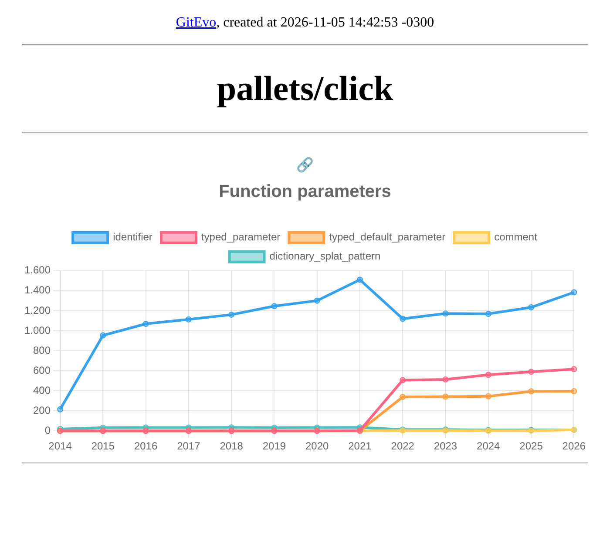

# Explorando evolução de código

Neste exercício, iremos explorar a evolução de código em sistemas reais.

Iremos utilizar a ferramenta [GitEvo](https://github.com/andrehora/gitevo).
Essa ferramenta analisa a evolução de código em repositórios Git nas linguagens Python, JavaScript, TypeScript e Java, e gera relatórios `HTML` como [este](https://andrehora.github.io/gitevo-examples/python/pandas.html).

Mais exemplos de relatórios podem ser podem ser encontrados em https://github.com/andrehora/gitevo-examples.

# Passo 1: Selecionar repositório a ser analisado

Selecione um repositório relevante na linguagem de sua preferência (Python, JavaScript, TypeScript ou Java).
Você pode encontrar projetos interessantes nos links abaixo:

- Python: https://github.com/topics/python?l=python
- JavaScript: https://github.com/topics/javascript?l=javascript
- TypeScript: https://github.com/topics/typescript?l=typescript
- Java: https://github.com/topics/java?l=java

# Passo 2: Instalar e rodar a ferramenta GitEvo

> [!NOTE]
> Antes de instalar a ferramenta, é recomendado criar e ativar um [ambiente virtual Python](https://packaging.python.org/en/latest/guides/installing-using-pip-and-virtual-environments/#create-and-use-virtual-environments).

Instale a ferramenta [GitEvo](https://github.com/andrehora/gitevo) com o comando:

```
$ pip install gitevo
```

Execute a ferramenta no repositório selecionado utilizando o comando abaixo (ajuste conforme a linguagem do repositório).
Substitua `<git_url>` pela URL do repositório que será analisado:

```shell
# Python
$ gitevo -r python <git_url>

# JavaScript
$ gitevo -r javascript <git_url>

# TypeScript
$ gitevo -r typescript <git_url>

# Java
$ gitevo -r java <git_url>
```

Por exemplo, para analisar o projeto Flask escrito em Python:

```
$ gitevo -r python https://github.com/pallets/flask
```

> [!NOTE]
> Essa etapa pode demorar alguns minutos pois o projeto será clonado e analisado localmente.

# Passo 3: Explorar o relatório de evolução de código

Após executar a ferramenta [GitEvo](https://github.com/andrehora/gitevo), é gerado um relatório `HTML` contendo diversos gráficos sobre a evolução do código.

Abra o relatório `HTML` e observe com atenção os gráficos.

# Passo 4: Explicar um gráfico de evolução de código

Selecione um dos gráficos de evolução e explique-o com suas palavras.
Por exemplo, você pode:

- Detalhar a evolução ao longo do tempo
- Detalhar se as curvas estão de acordo com boas práticas
- Explicar grandes alterações nas curvas
- Explorar a documentação do repositório em busca de explicações para grandes alterações
- etc.

Seja criativo!

# Instruções para o exercício

1. Crie um `fork` deste repositório (mais informações sobre forks [aqui](https://docs.github.com/pt/pull-requests/collaborating-with-pull-requests/working-with-forks/fork-a-repo)).
2. Adicione o relatório `HTML` no seu fork.
3. No Moodle, submeta apenas a URL do seu `fork`.

Responda às questões abaixo diretamente neste arquivo `README.md` do seu fork:

1. Repositório selecionado: https://github.com/pallets/click

   Relatório gerado com `gitevo -r python -f 2014 https://github.com/pallets/click`: [report_click.html](report_click.html)

2. Gráfico selecionado: **Function parameters**

   

3. Explicação:

   O gráfico conta, ano a ano, os tipos de parâmetros das funções do Click (biblioteca Python para criar interfaces de linha de comando). O GitEvo analisa o primeiro commit de cada ano. A linha `identifier` representa parâmetros simples **sem anotação de tipo** (inclusive `self` e `cls`). `typed_parameter` e `typed_default_parameter` são parâmetros **com anotação de tipo**, sem e com valor padrão.

   **2014 a 2021: crescimento sem tipos.** A linha `identifier` cresce continuamente (de 215 para 1.510), acompanhando o crescimento do código (de 1.839 para 15.275 linhas). Durante todo esse período não existe nenhum parâmetro tipado (as linhas vermelha e laranja ficam em zero). Isso era esperado: até a versão 7.x o Click ainda suportava Python 2, que não tem sintaxe de anotações de tipo.

   **2021 → 2022: a grande virada.** Entre o snapshot de 01/01/2021 (commit `4ae303e`) e o de 13/01/2022 (commit `ee5fdbf`), o gráfico muda de forma brusca:

   | Tipo de parâmetro | 2021 | 2022 |
   |---|---|---|
   | `identifier` (sem tipo) | 1.510 | 1.120 |
   | `default_parameter` (com valor padrão, sem tipo)* | 322 | 4 |
   | `typed_parameter` | 0 | 507 |
   | `typed_default_parameter` | 0 | 339 |

   \* `default_parameter` não aparece no gráfico (o GitEvo mostra só as 5 categorias mais frequentes no último ano), mas está no CSV do relatório.

   Ao investigar o histórico do repositório, encontrei a explicação:
   - A **versão 8.0.0** (lançada em 11/05/2021) tem como primeiro item do [CHANGES.md](https://github.com/pallets/click/blob/main/CHANGES.md): *"Drop support for Python 2 and 3.5"*. Sem a restrição do Python 2, passou a ser possível usar anotações de tipo.
   - O commit [`0103c95` "add typing annotations"](https://github.com/pallets/click/commit/0103c95) (PR [#1856](https://github.com/pallets/click/pull/1856), 23/04/2021) adicionou anotações em **22 arquivos** (+1.733 / −1.063 linhas). Ele criou o arquivo `py.typed`, que indica que o pacote expõe tipos, e configurou o **mypy em modo estrito** (`disallow_untyped_defs = True`, `disallow_incomplete_defs = True`) para `src/click`.

   É por causa do modo estrito que a mudança é tão abrupta. O mypy passou a rejeitar qualquer função sem anotação, então praticamente todos os parâmetros da biblioteca precisaram ser tipados de uma vez. Por isso os parâmetros com valor padrão sem tipo caem de 322 para apenas 4. Contei os parâmetros no snapshot de 2022 e confirmei isso: em `src/` há **805 parâmetros tipados e só 25 sem tipo** (fora `self`/`cls`). Os parâmetros sem tipo que sobram na linha azul estão quase todos em `tests/` (594) e `examples/` (125), que não são verificados pelo mypy, e em `self`/`cls` (383), que não precisam de anotação.

   **2022 a 2026: estabilidade e crescimento consistente.** Depois da migração, as três curvas crescem juntas e de forma suave (`typed_parameter` de 507 para 616 e `typed_default_parameter` de 339 para 396). Isso indica que o código novo já nasce tipado: a prática foi incorporada ao processo do projeto, com o mypy rodando no CI, em vez de ter sido um esforço pontual. O CHANGES.md das versões seguintes confirma isso, com vários itens de melhorias de tipagem (por exemplo, PRs #2805 e #3371).

   **Boas práticas.** A evolução está de acordo com boas práticas de Python moderno. Anotações de tipo melhoram a documentação, o autocompletar nas IDEs e a detecção de erros antes da execução. Isso é especialmente importante para uma **biblioteca** como o Click, já que os projetos que a usam herdam esses tipos através do `py.typed`. Outro ponto positivo é que a migração foi feita de uma vez, com o verificador em modo estrito, logo após abandonar o Python 2. Assim o projeto evitou ficar muito tempo em um estado parcialmente tipado. Um ponto que ainda poderia melhorar é que os testes e exemplos continuam sem tipos, o que é comum e aceitável, mas aparece no gráfico como a maior parte da linha `identifier`.


